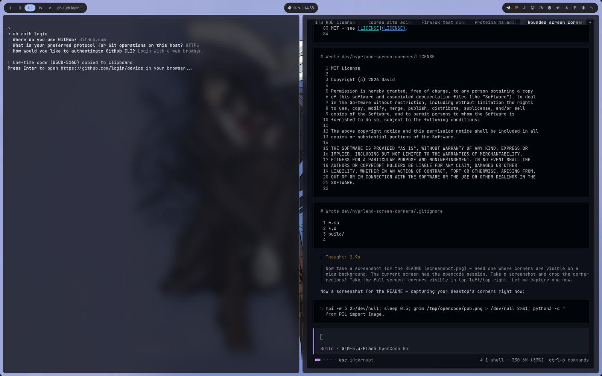

# Hyprland Screen Corners

A tiny [Hyprland](https://hyprland.org) plugin that paints smooth black rounded
corners onto **every monitor** — the "rounded glass" look of modern laptops and
monitors, without buying new hardware.

Works with any wallpaper and any amount of stacked windows: the corners stay
glued to the physical screen no matter what's underneath.



## Features

- Smooth anti-aliased quarter-circle corners on all four corners of every monitor
- Configurable radius and color
- Corner damage is tracked per frame, so the corners never get "eaten" by window redraws
- Correctly skips mirrors / screencopy, so your recordings and screenshares stay clean
- Tiny: masks are rasterized once on the CPU and drawn through the official
  `CTexPassElement` render path (the same one Hyprland uses for wallpapers and cursors)

## Requirements

- Arch Linux (or any distro) with the `hyprland` package installed — the plugin
  compiles against the system plugin headers that ship with it
- `pkg-config`, `git`, `gcc`, `make`

No `hyprpm` needed: the headers live in `/usr/include/hyprland`.

## Build & load

```bash
git clone https://github.com/<you>/hyprland-screen-corners
cd hyprland-screen-corners
make
hyprctl plugin load $PWD/screencorners.so
```

To load it on every Hyprland start, in `hyprland.conf`:

```ini
exec-once = hyprctl plugin load /path/to/hyprland-screen-corners/screencorners.so
```

(Lua config):

```lua
hl.exec_cmd("hyprctl plugin load /path/to/hyprland-screen-corners/screencorners.so")
```

## Configuration

```conf
plugin {
    screencorners {
        # radius in logical pixels (feathered with a per-pixel AA gradient)
        size = 20
        # corner color, fully opaque recommended
        color = rgba(000000ff)
    }
}
```

Changes apply on `hyprctl reload`, no recompilation needed.

## Rebuilding after a Hyprland update

The plugin links against the exact ABI of the installed Hyprland. After a
package update it may refuse to load; simply rebuild and reload:

```bash
cd hyprland-screen-corners && make && hyprctl plugin load $PWD/screencorners.so
```

## How it works

Registered in the last render stage, the plugin draws four corner masks as
`CTexPassElement`s (device-pixel positioned) and schedules a tiny corner
damage each frame so the compositor always redraws that region with our mask
on top — sustain cost is a handful of pixels per monitor per frame.

## License

MIT — see [LICENSE](LICENSE).
